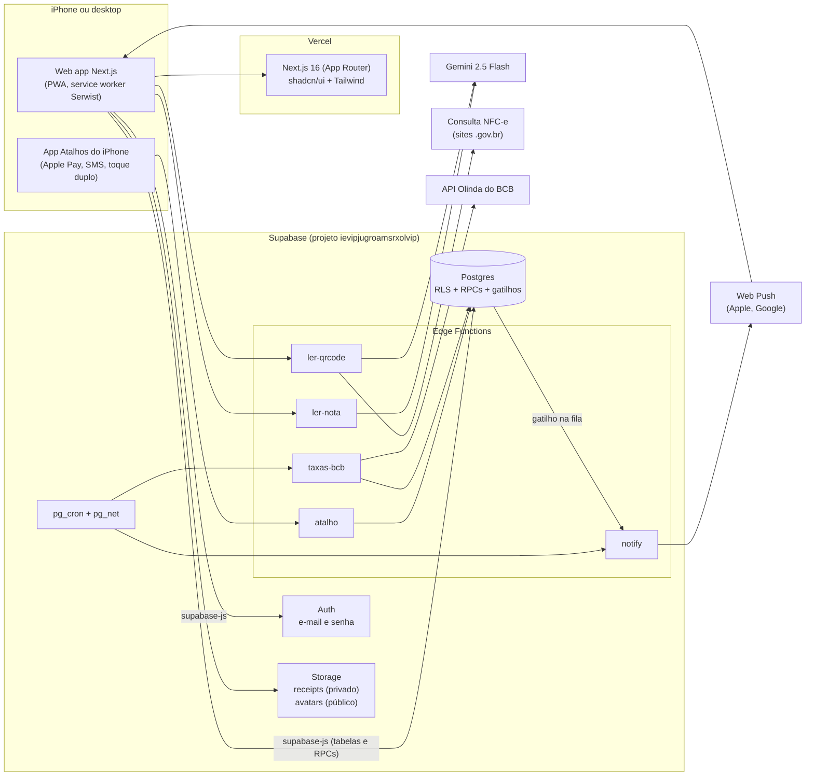
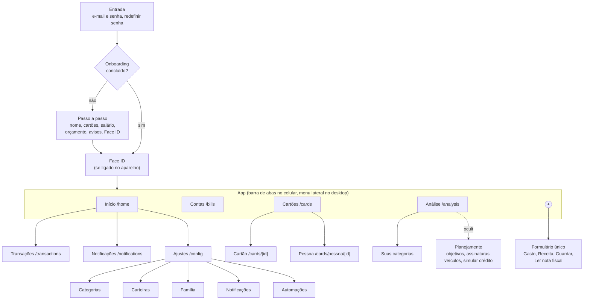
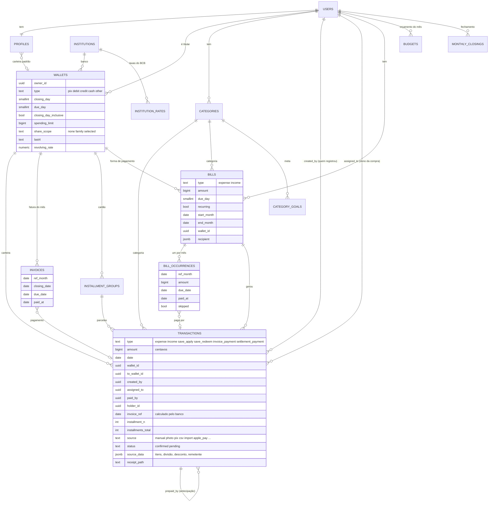
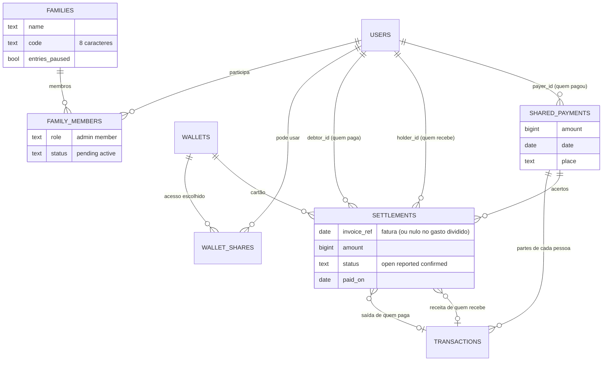
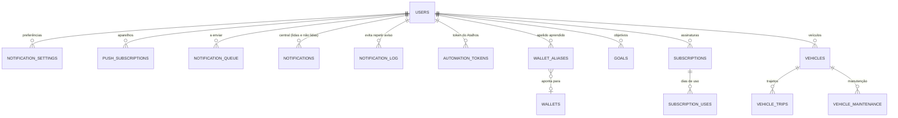
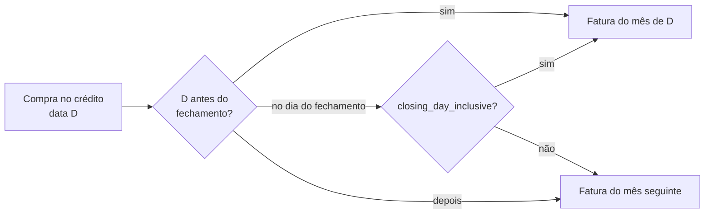
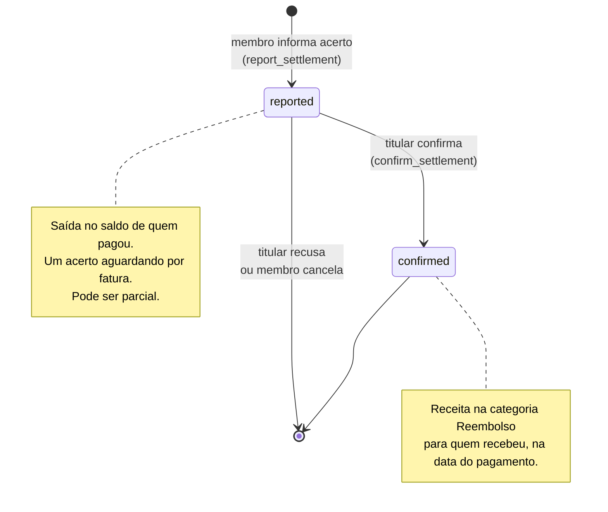
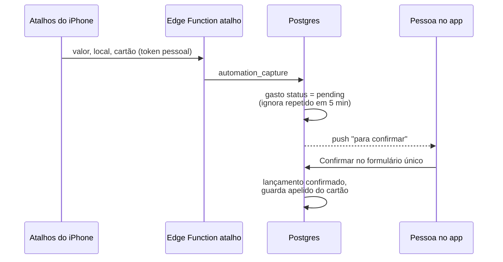

# Como o Troco funciona hoje

Retrato do app em 25/11/2026: arquitetura, telas, modelo de dados, regras de negócio e decisões. O schema foi lido direto do banco de produção nessa data. Detalhes de colunas e RPCs antigas ficam em [banco-de-dados.md](banco-de-dados.md); regras de texto em [content-design.md](content-design.md).

## Sumário

1. [Visão geral](#1-visão-geral)
2. [Arquitetura](#2-arquitetura)
3. [Telas e navegação](#3-telas-e-navegação)
4. [Modelo de dados](#4-modelo-de-dados)
5. [Regras de negócio](#5-regras-de-negócio)
6. [Automação e tarefas agendadas](#6-automação-e-tarefas-agendadas)
7. [Design system](#7-design-system)
8. [Decisões tomadas](#8-decisões-tomadas)
9. [Pendências e próximos passos](#9-pendências-e-próximos-passos)

## 1. Visão geral

Controle financeiro pessoal para a família (cerca de 3 pessoas com o app, mais convidados sem o app). Funciona como web app instalado na Tela de Início do iPhone e também no desktop.

O que ele faz:

- Registra gastos, receitas e o que foi guardado, em centavos.
- Controla cartões de crédito com fatura, parcelas, limite e atraso.
- Compartilha cartões com a família: cada compra tem um dono e cada pessoa vê o que deve.
- Divide compras entre pessoas (no cartão ou à vista) e controla os acertos.
- Mostra os gastos fixos do mês (Contas) e a análise contra o orçamento.
- Lê nota fiscal (foto ou QR code), PDF de fatura, CSV e OFX.
- Avisa por push: vencimentos, eventos da família, alertas de orçamento.

## 2. Arquitetura

Pontos principais:

- **Sem servidor próprio.** O navegador fala direto com o Supabase pelo `supabase-js` (`lib/supabase/client.ts`). O Next.js na Vercel só serve as telas.
- **Camada de API no cliente.** `lib/api/*.ts` faz as consultas e converte snake_case do banco para os tipos camelCase de `lib/types.ts` (`lib/supabase/mappers.ts`). As telas usam hooks com SWR (cache e revalidação).
- **Regras no banco.** Segurança por RLS em todas as tabelas. Escritas que envolvem outra pessoa passam por RPCs (`security definer`). Funções auxiliares e de gatilho ficam no schema `private`, fora da API pública.
- **Dinheiro sempre em centavos** (`bigint`), do banco até a tela. Só `formatCurrency` converte para reais na exibição.
- **Leitura pesada no aparelho.** PDF da fatura (pdf.js), QR code (jsQR), OCR de reserva (Tesseract.js), PDF de extrato (jsPDF) e recorte da foto de perfil rodam no celular.

### Pastas do código

| Pasta | O que tem |
|---|---|
| `app/` | Rotas (telas), service worker, tokens de design (`app/tokens/`) |
| `components/ios/` | Peças do visual iOS: `ListGroup`, `ListRow`, `FormRow`, `Panel`, `Stat`, `Screen`, `SegmentedControl`, `GlassButton` |
| `components/ui/` | Componentes shadcn (Button, Sheet, Popover, DropdownMenu, Sonner) |
| `components/shared/` | Componentes próprios reaproveitados: `Money`, `DateField`, `PickerRow`, `NumberField`, `CurrencyInput`, `EmptyState`, `Note` |
| `components/<área>/` | Telas por assunto: `transactions`, `cards`, `bills`, `home`, `analysis`, `family`, `receipt`, `pending`, `profile` etc. |
| `lib/api/` | Acesso ao banco por assunto |
| `lib/*.ts` | Regras puras: `invoice`, `split`, `discount`, `late-fee`, `finance`, `analysis`, `replan`, `reconcile`, `statement`, `search`, `business-days` |
| `supabase/migrations/` | Schema versionado (43 migrações) |
| `supabase/functions/` | Edge Functions |

## 3. Telas e navegação

| Tela | Para que serve |
|---|---|
| **Início** | Faixa rosa com saudação, busca e sino. Card com saldo, receitas e gastos do mês atual (valores sempre ocultos ao abrir). Pendentes, primeiros passos e "Atividade" (as 6 últimas registradas). |
| **Transações** | Lista do mês com busca em todos os meses, filtros por tipo, categoria e pagamento, e compras repetidas. |
| **Contas** | Só o que é fixo: gastos fixos a pagar, fixos no cartão e receitas fixas ("A receber"). Resumo Total, Pago e Falta. |
| **Cartões** | Faturas que vencem no mês. "Meus cartões", "Repassar" (o que devo nos cartões da família) e "A receber" (o que me devem nos meus). |
| **Cartão** | Fatura por mês, divisão por pessoa, limite usado, pagar fatura, conferir com o PDF. O membro vê só as próprias compras. |
| **Pessoa** | Faturas de cada cartão entre mim e a pessoa, gastos divididos, acertos e a fatura geral com PDF. |
| **Análise** | Gasto contra orçamento, ritmo, livre por dia, categorias com meta, histórico de 6 meses, replanejar metas. |
| **Ajustes** | Perfil e foto, tema, categorias, carteiras, família, notificações, automações, Face ID, senha, importar e exportar, sair e excluir conta. |

**Formulário único.** O botão + abre Gasto, Receita, Guardar ou Ler nota fiscal. Tocar em qualquer lançamento abre esse mesmo formulário (`QuickAddSheet`) em modo edição, com tudo editável. Gasto fixo e receita fixa são o próprio Gasto ou Receita com "Repetir todo mês".

## 4. Modelo de dados

28 tabelas no schema `public`, todas com RLS. Toda tabela de dados pessoais aponta para `auth.users` pelo dono (`user_id`, `owner_id`, `created_by` ou `assigned_to`). Mês de referência sempre gravado no dia 1.

### 4.1 Núcleo financeiro

### 4.2 Família, compartilhamento e acertos

Como as pessoas se ligam a uma compra:

| Coluna em `transactions` | Significado |
|---|---|
| `created_by` | Quem registrou |
| `assigned_to` | De quem é a compra (quem deve). Na fatura, o titular vê por pessoa. |
| `wallet_id` → `wallets.owner_id` | Titular do cartão |
| `paid_by` | Quem pagou de fato, no gasto dividido à vista. Sai do saldo dessa pessoa. |
| `holder_id` | Compra pendente em que só se sabe de quem é o cartão ("Não lembro o cartão") |

### 4.3 Avisos, automações e módulos de apoio

Objetivos, assinaturas e veículos existem no banco e nas rotas, mas o grupo Planejamento está oculto na Análise.

### 4.4 Views, storage e dados de referência

| Objeto | O que entrega |
|---|---|
| `invoice_totals` (view) | Total da fatura por cartão, mês e pessoa; quanto foi antecipado (`prepaid`) e quanto é fixo ainda não cobrado (`scheduled`) |
| `invoice_paid` (view) | Quanto já foi pago de cada fatura, sem contar antecipações de compra |
| `card_limit_used` (view) | Limite usado: tudo o que falta pagar no cartão, de todas as pessoas |
| `category_usage` (view) | Quantos lançamentos cada categoria tem |
| `institutions` | Bancos, juros da fatura, mora, multa, IOF, nomes no BCB |
| `institution_rates` | Taxas médias semanais do BCB por banco e produto |
| Bucket `receipts` (privado, 5 MB) | Fotos de nota, pasta por usuário |
| Bucket `avatars` (público, 1 MB) | Foto de perfil, 512 px comprimida |
| Schema `import` | Dados brutos da planilha antiga, só como referência |

## 5. Regras de negócio

### 5.1 Saldo e caixa

- O saldo segue o regime de caixa. Compra no crédito só sai do saldo quando a fatura é paga. A análise de gastos usa a data da compra.
- A regra está em `private.cash_effect`:
  - gasto com `paid_by` sai do saldo de quem pagou;
  - gasto à vista sai do saldo do dono;
  - gasto no crédito não mexe no saldo (o pagamento da fatura mexe);
  - receita e resgate entram; guardar, pagar fatura e pagar acerto saem.
- Fechamento mensal (`monthly_closings`): no dia 1, o mês anterior é fechado com saldo inicial, entradas, saídas, guardado e saldo final. Lançamento antigo alterado recalcula os meses seguintes. Com "saldo acumulado" ligado, o mês começa com o saldo final do anterior.

### 5.2 Fatura do cartão

- O banco calcula `invoice_ref` sozinho em todo gasto (`private.invoice_ref_for`). Dia 31 em mês curto vira o último dia (`clamp_day`).
- Total cobrado = soma das compras menos as antecipadas. Pagamento pode ser parcial; a fatura só fica paga quando os pagamentos cobrem o total (`pay_invoice`, `unpay_invoice` desfaz).
- Antecipar compra ou parcela (`prepay_purchase`) cria um pagamento ligado à compra pelo `prepaid_by`.
- Vencimento em fim de semana ou feriado nacional pode ser pago no próximo dia útil sem atraso (`lib/business-days.ts`). O fechamento não muda.
- Atraso estimado (`lib/late-fee.ts`): rotativo composto, mora 1%, multa 2%, IOF, teto de 100% da dívida (Lei 14.690/2023). Taxa usada: a da fatura do cartão, depois a do banco, depois a média do BCB.
- **Limite usado** (`card_limit_used`): tudo o que falta pagar no cartão, de todas as pessoas, inclusive fatura fechada não paga e parcelas futuras. Tira faturas pagas, pagamentos parciais, antecipações e gastos fixos ainda não cobrados.
- Conferir pelo PDF: o app lê o PDF da fatura no celular, casa com as compras do app e mostra o que falta, o que sobra e o que bate.

### 5.3 Parcelamento

- Compra parcelada cria um `installment_groups` (total, número de parcelas, primeira data) e uma transação por parcela, cada uma na sua fatura.
- **Só registra daqui em diante:** com "Parcela atual", entram só as parcelas da atual em diante. A parcela k cai na data da compra mais k-1 meses.
- Valor pode ser informado como total ou como valor da parcela.
- Carteira do tipo "Outro" (linha de crédito) também parcela: cada parcela é um gasto à vista no seu mês.
- Itens da compra, comprovante, dono e categoria valem para todas as parcelas.

### 5.4 Compartilhamento de cartões e família

- Família: criada por alguém (admin), outras pessoas entram com o código de 8 caracteres e esperam aprovação. Admin que sai passa o papel ao membro mais antigo.
- "Pessoa sem o app": convidado criado pelo admin (`profiles.is_guest`), recebe compras como qualquer membro e tem a fatura em PDF.
- Cartão de crédito pode ser compartilhado com ninguém, com toda a família ou com pessoas escolhidas (`wallet_shares`). Só cartão de crédito é compartilhável.
- Quem usa o cartão de outra pessoa vê só o nome, acabamento, final, fechamento e vencimento (`shared_wallets`), nunca o resto da carteira.
- **De quem é a compra:** `assigned_to`. Compra sem nome de pessoa é da dona do cartão. Mudar o dono (`assign_purchase`) vale para todas as parcelas e é bloqueado com fatura paga.
- Visibilidade: o titular vê todas as compras do cartão; o membro vê só as dele.
- Depois do fechamento da fatura, só o titular altera ou exclui compras do cartão (gatilho `transactions_before_write`).
- Na aba Cartões: "Repassar" mostra o que devo nos cartões da família, uma linha por titular; "A receber" mostra o que cada pessoa me deve nos meus. Só faturas que vencem até o mês escolhido, nunca parcelas futuras.

### 5.5 Divisão entre pessoas

**No cartão de crédito** (`split_purchase`):

- Igual, por valor, por % ou por item (cada item com a sua pessoa, ou "Dividir" o item entre todos).
- Cada pessoa ganha a própria transação; na parcelada, a própria compra parcelada (`installment_groups` novo).
- Todas as partes guardam todos os itens com o dono (`source_data.items[].owner`), a divisão da compra inteira (`split_parts`) e o calendário por parcela (`split_schedule`).
- Na fatura do titular, a compra dividida aparece numa linha só.

**À vista: Pix, débito, dinheiro** (`create_shared_payment`):

- Cria um `shared_payments` com quem pagou, total, data e local.
- Cada pessoa com parte ganha um gasto no próprio nome, com `paid_by` = quem pagou.
- O gasto sai só do saldo de quem pagou. Quem deve só tem saída ao informar o acerto.
- Valor, data e pessoas só mudam excluindo o gasto dividido inteiro (`delete_shared_payment`, bloqueado se já houver acerto).

### 5.6 Acertos

- Acerto pode ser de fatura (`invoice_ref`) ou de gasto dividido (`shared_payment_id`).
- Não aceita valor acima do que falta nem data futura.
- Quem pagou sem o app tem o acerto já confirmado; quem pagou registra o recebimento de quem não tem o app.
- Toda etapa gera aviso para a outra pessoa.

### 5.7 Fatura geral por pessoa

Na tela da pessoa, "Ver fatura geral" junta tudo do mês nos dois sentidos: minhas compras nos cartões dela, as dela nos meus e os gastos divididos. Mostra o saldo final de quem deve a quem e exporta um PDF único (`generalStatementPdf`).

### 5.8 Contas (gastos e receitas fixos)

- `bills` guarda a regra (valor, dia, início, fim, forma de pagamento, destinatário). `bill_occurrences` guarda cada mês (gerado por `ensure_bill_occurrences` todo dia, para o mês atual e o seguinte).
- Fim: sem fim, até um mês ou número de vezes (`end_month`).
- **Fixo no cartão de crédito:** o banco lança o gasto na fatura na data da conta e marca o mês como pago. Não conta no limite usado antes da data.
- **Fixo em Pix, débito ou dinheiro:** fica a pagar; "Pagar" gera o gasto (`pay_bill_occurrence`).
- **Receita fixa:** aparece em "A receber"; "Receber" gera a receita.
- **Pagar depois:** gasto único a pagar (`recurring = false`).
- Excluir: "Só este mês" (pula o mês) ou "Este e os próximos" (encerra). Excluir o lançamento de um pagamento devolve o mês para a pagar.
- Fixar gasto: deslizar um gasto à vista e tocar em Fixar transforma em gasto fixo a partir daquele mês (`pin_transaction`).
- Valor que muda por mês: no Novo gasto, nome igual ao de um fixo em aberto oferece "Pagar gasto fixo", que muda só o valor daquele mês.

### 5.9 Desconto

- "Teve desconto?" em % ou R$ no gasto avulso. O valor digitado é o sem desconto; o lançamento sai com o desconto abatido.
- Fica em `source_data.discount` (`kind`, `percent`, `amount`, `gross`), sempre da compra inteira.
- Parcelas recebem o total com desconto. Na divisão, as partes são calculadas sobre o valor cheio e reduzidas na mesma proporção (`lib/discount.ts`).

### 5.10 Pendentes e automações

- Pendentes vêm do Atalhos (Apple Pay, SMS, toque duplo), de Pix recebido de alguém da família e de compra com "Não lembro o cartão".
- Saldos e listas só contam `status = 'confirmed'`.
- Pix para alguém da família vira receita pendente para a pessoa, que confirma.
- "Não lembro o cartão": a compra fica pendente com `holder_id`; o titular escolhe o cartão e as parcelas são lançadas (`resolve_card_pending`).

### 5.11 Nota fiscal

1. A foto é reduzida no celular e procura-se o QR code da NFC-e.
2. Com QR de site `.gov.br`, a função `ler-qrcode` lê a página da Sefaz (local, data, total, itens, pagamento).
3. Sem QR, a função `ler-nota` usa o Gemini. Sem cota ou com erro, o celular usa o Tesseract.
4. A categoria vem do histórico e de palavras-chave; o Gemini só sugere quando não há QR.
5. A foto fica em rascunho e só vira comprovante ao salvar o gasto. Nota repetida (mesma chave de acesso) é avisada.

### 5.12 Foto de perfil

- Recorte quadrado no app (arrastar, pinçar, roda do mouse), redução para 512 px e compressão (WebP; JPEG no Safari), cerca de 20 a 60 KB.
- Só envia ao Salvar, para `avatars/<id>/`, apaga as anteriores e guarda a URL em `profiles.avatar_url`.
- Aparece no lugar da inicial no Início, em Ajustes, na família e nos cartões.

### 5.13 Segurança e privacidade

- RLS em todas as tabelas: cada pessoa lê o que é dela, o titular lê o cartão dele, o membro lê as compras atribuídas a ele.
- Escrita em `settlements`, família e divisão só por RPC.
- Face ID local por aparelho (WebAuthn), pedido ao abrir e após 1 minuto fora.
- Excluir a conta apaga os dados da pessoa; membros mantêm as próprias compras feitas no cartão dela, com o nome do cartão guardado.

## 6. Automação e tarefas agendadas

| Tarefa | Quando | O que faz |
|---|---|---|
| `troco-notify` | A cada 10 min | Envia a fila de avisos e os agendados: contas a vencer, lembrete de registro, resumo de domingo, orçamento 80% e 100%, ritmo acima do ideal, gasto fora do padrão, fatura compartilhada fechada. Limpa fotos de contas excluídas. |
| Gatilho em `notification_queue` | Na hora | Avisos da família (compra no meu cartão, acerto, Pix, cartão definido) saem na hora e vão para a central de notificações. |
| `troco-bill-occurrences` | Todo dia, 03:17 UTC | Gera as contas do mês atual e do seguinte e lança os fixos no cartão. |
| `troco-monthly-closing` | Dia 1, 03:33 UTC | Fecha o mês anterior de todo mundo. |
| `troco-bcb-rates` | Segunda, 09:17 UTC | Atualiza as taxas médias do BCB por banco. |

Gatilhos em `transactions`: validação e cálculo da fatura, avisos de compra e de atribuição, recálculo dos fechamentos, Pix para a família, "Qual cartão foi?" e devolução da conta a pagar quando o pagamento é excluído.

## 7. Design system

- **Visual iOS 26 com Liquid Glass**: vidro transparente nos botões circulares e nas folhas; barra de abas em cápsula, só ícones, com fundo sólido.
- **Cor principal:** rosa da marca (Cyclamen, #EA6993), em botões, aba ativa, seleção, links e foco. Início com faixa rosa.
- **Fonte:** Manrope.
- **Ícones:** Solar (`@solar-icons/react`). Traço (`Linear`) quando inativo, preenchido (`Bold`) quando selecionado.
- **Tokens em camadas:** primitivos (valores brutos) → semânticos (uso, com claro e escuro) → componentes usam só os semânticos. Sem cor, tamanho ou sombra solta no código.
- **App modular:** todo elemento que se repete é um componente com variantes (`cva`); a instância só escolhe a variante.
- **Categorias sempre cinza**, em ordem alfabética.
- **Textos** seguem o guia de conteúdo: botão no infinitivo com até 2 palavras, rótulos curtos, glossário fixo (Excluir, Gasto).
- **Desktop:** menu lateral, conteúdo centralizado e folhas como cartão no meio da tela. O celular não muda.

## 8. Decisões tomadas

| Decisão | Por quê |
|---|---|
| Supabase no lugar de Apps Script e Google Sheets (15/11/2026) | O uso passou a ser da família, com login, privacidade e cartões compartilhados. |
| Contas e Cartões em abas separadas | Contas mostra só o fixo, o dinheiro já reservado, que não dá para economizar. |
| Só registra daqui em diante | Dívidas e parcelas antigas ficam como acertadas; parcelas entram da atual em diante. Os dados da planilha antiga não foram importados. |
| Tocar em qualquer gasto abre o mesmo formulário, tudo editável | Telas de detalhe diferentes confundiam e travavam campos em casos diferentes. |
| Compra sem nome de pessoa é da dona do cartão | Padrão ao lançar faturas e importar. |
| Saldo pelo regime de caixa | O crédito só pesa no saldo quando a fatura é paga. |
| Orçamento do mês independente das metas por categoria | Teto geral e metas são controles separados. |
| Entrada na família com aprovação do admin | Evita entrada por código vazado. |
| Compra no dia do fechamento entra na fatura que fecha, ajustável por cartão | Bancos diferem; o Nubank 0514 foi ajustado para não incluir o dia. |
| Planejamento oculto na Análise | Objetivos, assinaturas, veículos e simulador ficam para depois. |
| Categorias sempre cinza e em ordem alfabética | Visual mais limpo; a cor no banco é ignorada. |
| Barra de status opaca (`statusBarStyle = 'default'`) | No iOS 26.1+, o app instalado ganha um desfoque do Liquid Glass no topo que a página não consegue desligar. A faixa `StatusBarStrip` pinta a área com cor lisa. |
| Altura da tela por `window.innerHeight` e só o `<main>` rola | No iOS 26 a área desenhada pode ser menor que `100lvh`, e a barra ficava cortada. |
| Open Finance não será feito | O atraso de um dia atrapalha o registro na hora. |
| Gemini só para foto sem QR code | O QR da NFC-e dá dados oficiais; a IA fica como reserva. |
| Valores sempre ocultos ao abrir o app | Privacidade; a escolha do olho não é gravada. |
| Login com Google pronto, mas oculto | Falta configurar o provedor no Supabase. |

## 9. Pendências e próximos passos

- **Permissão de "contadora" do cartão:** pessoa que não é dona do cartão, mas gerencia tudo dele como a titular.
- Backup periódico.
- Login por código de 6 dígitos.
- Divisão de compra no débito.
- Leitura do QR code da NFC-e ainda sem teste com nota real.
- Planejamento (objetivos, assinaturas, veículos, simulador) ainda oculto.
